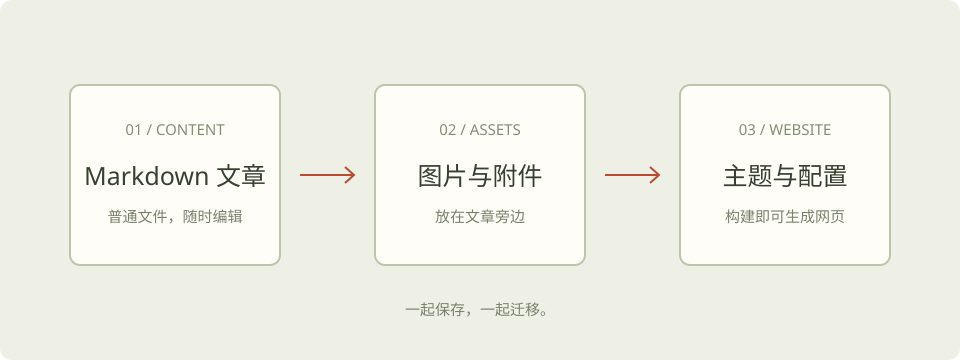

一个博客应该能陪你很久。服务器会更换，托管平台会变化，但你写下的内容可以一直保留。

把内容和服务器分开，是让博客容易迁移的第一步。

## 先把文章保存成文件

一篇文章就是一个 Markdown 文件。它可以在普通文本编辑器里打开，可以放进 Git 仓库，也可以复制到移动硬盘。

```text
src/content/blog/
└── portable-blog/
    ├── index.md
    └── notebook.svg
```

图片放在文章旁边，使用相对路径引用：

```markdown

```


这样迁移时，不需要一张张寻找图片，也不用批量修改图床地址。

## 静态博客怎样工作

Astro 在构建时，把 Markdown 文章和页面模板转换成 HTML、CSS 和其他静态资源。

```text
Markdown + 图片 + 页面模板
          ↓ 构建
        dist/
          ↓ 上传
   任何支持静态文件的服务器
```

访问者阅读的是生成后的网页。服务器只需要提供这些文件，不需要常驻的 Node.js 应用或数据库。

> Node.js 用来构建网站；生成好的静态网站，可以交给 Nginx、Caddy 或静态托管平台提供访问。

## 迁移时带走什么

有两种不同的备份，它们各有用途。

| 备份 | 包含内容 | 用途 |
| --- | --- | --- |
| 源码备份 | 文章、图片、模板、配置、依赖锁文件 | 继续写作、修改和重新构建 |
| 成品备份 | 构建生成的 dist 目录 | 快速恢复网站访问 |

只备份生成后的网页，可以恢复阅读，但继续维护会很不方便。只备份源码，则需要可用的构建环境才能生成网页。两份一起保存更稳妥。

本项目提供打包命令：

```sh
npm run package
```

它会先构建并检查网站，再把源码和静态网页分别打包到 `release/`。请将这些文件额外保存到自己的电脑或其他备份位置。

## 域名让链接保持稳定

本站以 `https://howdo.icu` 作为正式地址。更换服务器时，尽量保持域名和文章路径不变。

例如，一篇文章发布在：

```text
https://howdo.icu/articles/portable-blog/
```

新服务器继续提供相同路径，旧链接就能继续使用。发布后不要随意修改文章文件夹名，因为它决定了文章的网址。

如果路径必须变更，应当给旧地址配置重定向。

## 一次迁移的检查顺序

1. 在旧服务器到期之前，准备新服务器。
2. 上传静态文件，配置 Web 服务器和 HTTPS。
3. 检查首页、文章、图片、RSS、站点地图和不存在的路径。
4. 将域名的 DNS 记录切换到新服务器。
5. 等待 DNS 缓存更新，并复查正式域名的访问结果。

迁移完成的标准不只是「首页能打开」。文章里的图片、代码、内部链接和错误页也应该正常。

## 给未来的自己留一张说明

把写作和部署步骤放在仓库里。几个月以后重新打开项目，不需要回忆当时安装过什么、配置放在哪里。

- `README.md`：如何运行和构建。
- `WRITING.md`：如何新增文章、插入图片。
- `MIGRATION.md`：如何打包、恢复和迁移。

内容是长期积累的，承载它的服务器可以随时更换。
